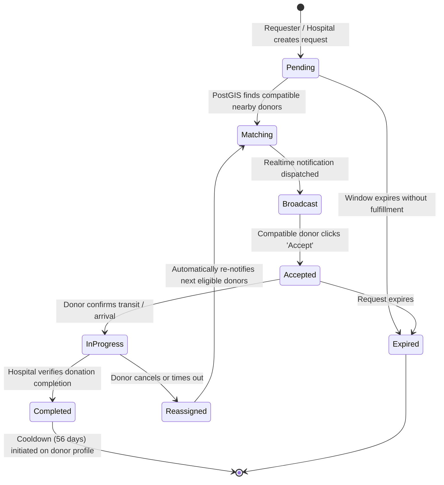

# System Architecture & Technical Specification

**Project:** BloodLink  
**Document:** System Architecture  
**Status:** In-Place Rebuild Specification  

---

## 1. High-Level Architecture Overview

BloodLink is architected as a modern, high-resilience, event-driven web application tailored for time-critical blood matching and secure donor management.

```mermaid
graph TD
    UserClient[Web Browser: React 19 + TypeScript + Vite]
    
    subgraph UI_Layer [Frontend Layer]
        Router[React Router 7]
        State[Zustand / TanStack Query Store]
        UIComponents[shadcn/ui + Tailwind CSS 4 Design System]
        MapModule[Leaflet + OpenStreetMap Engine]
    end

    subgraph Security_Privacy [Security & Access Control Layer]
        AuthEngine[Supabase Auth / JWT Session Guard]
        RLSPolicies[PostgreSQL Row Level Security (RLS)]
        PrivacyProxy[Location Fuzzing & Contact Masking]
    end

    subgraph Data_Layer [PostgreSQL Relational Core]
        UsersTable[(users / profiles)]
        DonorsTable[(donor_profiles)]
        RequestsTable[(blood_requests)]
        AssignmentsTable[(donor_assignments)]
        InventoryTable[(hospital_inventory)]
        AuditTable[(audit_logs)]
        NotificationsTable[(notifications)]
    end

    subgraph Realtime_Alerts [Real-Time Notification Core]
        RealtimeChannel[Supabase Realtime / WebSocket Engine]
        FallbackAlerts[In-App Toast & Persistent Notification Center]
    end

    UserClient --> Router
    Router --> UIComponents
    UIComponents --> MapModule
    UIComponents --> State
    State --> AuthEngine
    AuthEngine --> RLSPolicies
    RLSPolicies --> Data_Layer
    Data_Layer --> RealtimeChannel
    RealtimeChannel --> UserClient
    PrivacyProxy --> State
```

---

## 2. Component Architecture

### 2.1 Frontend Architecture (`client/src/`)
- **`app/`**: Root configuration, global context providers (AuthContext, ThemeContext, NotificationContext).
- **`components/ui/`**: Accessible, styled design system primitives based on Radix UI / shadcn (Button, Dialog, Badge, Input, Card, Sheet, Dropdown, Table, Skeleton, Alert).
- **`components/common/`**: Application-wide shared components (Navbar, Sidebar, Footer, MapView, LocationPicker, StatusPill, UserAvatar).
- **`modules/`**: Domain feature modules organized by responsibility:
  - `auth/`: Login, Register, ForgotPassword, ResetPassword, CompleteProfile.
  - `donor/`: DonorDashboard, DonorProfile, AvailabilityToggle, DonationHistory, BadgesView.
  - `requester/`: CreateRequestWizard, RequestTracker, FulfillmentProgress, RequestHistory.
  - `hospital/`: HospitalDashboard, InventoryManager, DonorVerificationQueue, EmergencyBulkOrder.
  - `admin/`: AdminDashboard, UserDirectory, DonorVerificationAudit, BroadcastManager, AnalyticsView, AuditLogs.
- **`lib/`**: Supabase client, utility functions, Leaflet map helpers, date formatters, blood compatibility matrix.
- **`types/`**: Full TypeScript type definitions for all entities, requests, responses, and events.

---

## 3. Data Flow & Event Lifecycle

### 3.1 Blood Request Lifecycle


---

## 4. Resilience & Graceful Degradation Strategy

1. **Zero External Crashing Services:** All external SDK initializations (Email, SMS, Cloud Storage) are wrapped in resilient service adapters that detect missing credentials and fallback to mock development handlers with rich console diagnostics.
2. **Offline-Tolerant Mapping:** Leaflet tiles utilize standard OpenStreetMap CDN with browser caching. If tiles fail to load, coordinate distances and tabular list discovery remain 100% operational.
3. **Optimistic UI Updates with Rollback:** State mutations (e.g. toggling availability) provide immediate UI feedback while verifying transaction success with the backend.
