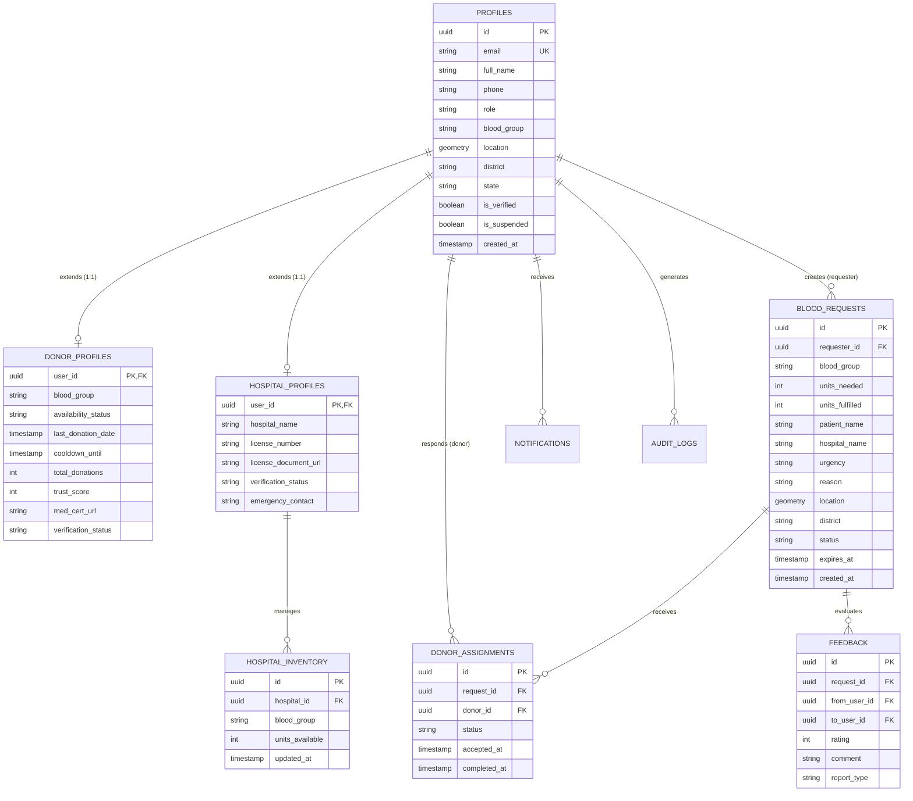

# Relational Database Schema & Entity-Relationship Design

**Project:** BloodLink Rebuild  
**Database Engine:** PostgreSQL 15+ / Supabase  
**Design Paradigm:** Normalized Relational with Foreign Keys, Check Constraints, Row Level Security (RLS), and PostGIS Spatial Indexing.

---

## 1. Entity-Relationship Overview



---

## 2. Detailed Table DDL & Schema Definitions

### 2.1 `profiles` Table
```sql
CREATE TYPE user_role AS ENUM ('donor', 'requester', 'hospital', 'admin');
CREATE TYPE blood_group_type AS ENUM ('A+', 'A-', 'B+', 'B-', 'AB+', 'AB-', 'O+', 'O-');

CREATE TABLE profiles (
    id UUID PRIMARY KEY REFERENCES auth.users(id) ON DELETE CASCADE,
    email TEXT UNIQUE NOT NULL,
    full_name TEXT NOT NULL,
    phone TEXT,
    role user_role NOT NULL DEFAULT 'donor',
    blood_group blood_group_type,
    latitude DOUBLE PRECISION,
    longitude DOUBLE PRECISION,
    location GEOMETRY(Point, 4326),
    district TEXT NOT NULL DEFAULT '',
    state TEXT NOT NULL DEFAULT '',
    formatted_address TEXT,
    avatar_url TEXT,
    is_verified BOOLEAN NOT NULL DEFAULT FALSE,
    is_suspended BOOLEAN NOT NULL DEFAULT FALSE,
    created_at TIMESTAMPTZ NOT NULL DEFAULT NOW(),
    updated_at TIMESTAMPTZ NOT NULL DEFAULT NOW()
);

CREATE INDEX idx_profiles_role ON profiles(role);
CREATE INDEX idx_profiles_district ON profiles(district);
CREATE INDEX idx_profiles_location ON profiles USING GIST(location);
```

### 2.2 `donor_profiles` Table
```sql
CREATE TYPE availability_enum AS ENUM ('available', 'unavailable', 'on-cooldown');
CREATE TYPE verification_enum AS ENUM ('pending', 'approved', 'rejected');

CREATE TABLE donor_profiles (
    user_id UUID PRIMARY KEY REFERENCES profiles(id) ON DELETE CASCADE,
    blood_group blood_group_type NOT NULL,
    availability_status availability_enum NOT NULL DEFAULT 'unavailable',
    last_donation_date DATE,
    cooldown_until DATE,
    total_donations INT NOT NULL DEFAULT 0 CHECK (total_donations >= 0),
    trust_score INT NOT NULL DEFAULT 50 CHECK (trust_score BETWEEN 0 AND 100),
    med_cert_url TEXT,
    verification_status verification_enum NOT NULL DEFAULT 'pending',
    verified_by UUID REFERENCES profiles(id),
    verified_at TIMESTAMPTZ,
    badges JSONB NOT NULL DEFAULT '[]'::jsonb,
    created_at TIMESTAMPTZ NOT NULL DEFAULT NOW(),
    updated_at TIMESTAMPTZ NOT NULL DEFAULT NOW()
);

CREATE INDEX idx_donor_availability ON donor_profiles(blood_group, availability_status, verification_status);
```

### 2.3 `blood_requests` Table
```sql
CREATE TYPE request_urgency AS ENUM ('normal', 'urgent', 'critical');
CREATE TYPE request_status AS ENUM ('pending', 'accepted', 'in-progress', 'completed', 'expired', 'cancelled');

CREATE TABLE blood_requests (
    id UUID PRIMARY KEY DEFAULT gen_random_uuid(),
    requester_id UUID NOT NULL REFERENCES profiles(id) ON DELETE CASCADE,
    blood_group blood_group_type NOT NULL,
    units_needed INT NOT NULL CHECK (units_needed > 0 AND units_needed <= 20),
    units_fulfilled INT NOT NULL DEFAULT 0 CHECK (units_fulfilled >= 0 AND units_fulfilled <= units_needed),
    patient_name TEXT NOT NULL,
    contact_phone TEXT NOT NULL,
    hospital_name TEXT NOT NULL,
    urgency request_urgency NOT NULL DEFAULT 'normal',
    reason TEXT NOT NULL,
    proof_document_url TEXT,
    latitude DOUBLE PRECISION NOT NULL,
    longitude DOUBLE PRECISION NOT NULL,
    location GEOMETRY(Point, 4326),
    formatted_address TEXT NOT NULL,
    district TEXT NOT NULL,
    status request_status NOT NULL DEFAULT 'pending',
    notes TEXT,
    expires_at TIMESTAMPTZ NOT NULL,
    created_at TIMESTAMPTZ NOT NULL DEFAULT NOW(),
    updated_at TIMESTAMPTZ NOT NULL DEFAULT NOW()
);

CREATE INDEX idx_requests_status ON blood_requests(status, blood_group);
CREATE INDEX idx_requests_location ON blood_requests USING GIST(location);
CREATE INDEX idx_requests_district ON blood_requests(district);
```

### 2.4 `donor_assignments` Table
```sql
CREATE TYPE assignment_status AS ENUM ('pending', 'accepted', 'in-progress', 'completed', 'cancelled', 'reassigned');

CREATE TABLE donor_assignments (
    id UUID PRIMARY KEY DEFAULT gen_random_uuid(),
    request_id UUID NOT NULL REFERENCES blood_requests(id) ON DELETE CASCADE,
    donor_id UUID NOT NULL REFERENCES profiles(id) ON DELETE CASCADE,
    status assignment_status NOT NULL DEFAULT 'pending',
    accepted_at TIMESTAMPTZ DEFAULT NOW(),
    completed_at TIMESTAMPTZ,
    notes TEXT,
    created_at TIMESTAMPTZ NOT NULL DEFAULT NOW(),
    UNIQUE(request_id, donor_id)
);

CREATE INDEX idx_assignments_req_donor ON donor_assignments(request_id, donor_id);
```

---

## 3. Database Functions & Atomic Request Fulfillment

To eliminate race conditions when donors accept requests:

```sql
CREATE OR REPLACE FUNCTION accept_blood_request(p_request_id UUID, p_donor_id UUID)
RETURNS JSONB
LANGUAGE plpgsql
SECURITY DEFINER
AS $$
DECLARE
    v_req blood_requests%ROWTYPE;
    v_donor donor_profiles%ROWTYPE;
    v_assignment_id UUID;
BEGIN
    -- 1. Lock the request row exclusively to prevent concurrent race condition
    SELECT * INTO v_req FROM blood_requests WHERE id = p_request_id FOR UPDATE;
    IF NOT FOUND THEN
        RETURN jsonb_build_object('success', false, 'error', 'Request not found');
    END IF;

    IF v_req.status IN ('completed', 'expired', 'cancelled') THEN
        RETURN jsonb_build_object('success', false, 'error', 'Request is no longer active');
    END IF;

    IF v_req.units_fulfilled >= v_req.units_needed THEN
        RETURN jsonb_build_object('success', false, 'error', 'All units have already been fulfilled');
    END IF;

    -- 2. Verify donor availability
    SELECT * INTO v_donor FROM donor_profiles WHERE user_id = p_donor_id;
    IF NOT FOUND OR v_donor.availability_status != 'available' THEN
        RETURN jsonb_build_object('success', false, 'error', 'Donor is not currently available');
    END IF;

    -- 3. Check for existing assignment
    IF EXISTS (SELECT 1 FROM donor_assignments WHERE request_id = p_request_id AND donor_id = p_donor_id AND status != 'cancelled') THEN
        RETURN jsonb_build_object('success', false, 'error', 'Already assigned to this request');
    END IF;

    -- 4. Create assignment and update request
    INSERT INTO donor_assignments (request_id, donor_id, status)
    VALUES (p_request_id, p_donor_id, 'accepted')
    RETURNING id INTO v_assignment_id;

    UPDATE blood_requests
    SET status = CASE WHEN status = 'pending' THEN 'accepted' ELSE status END
    WHERE id = p_request_id;

    RETURN jsonb_build_object('success', true, 'assignment_id', v_assignment_id);
END;
$$;
```
