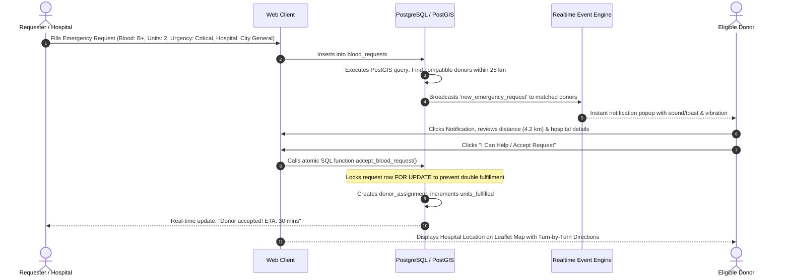
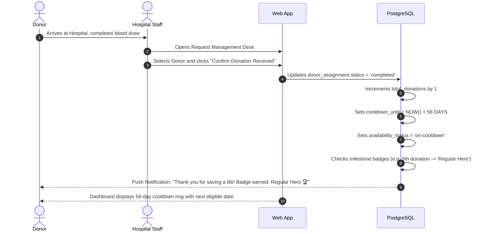

# Critical User Flows & Interaction Journeys

**Project:** BloodLink Rebuild  
**Document Version:** 1.0.0  

---

## Flow 1: Donor Registration, Verification & Availability

```mermaid
sequenceDiagram
    autonumber
    actor Donor as New Donor
    participant Web as BloodLink Web App
    participant Auth as Auth Engine
    participant DB as PostgreSQL (Supabase)
    actor Hospital as Hospital / Admin

    Donor->>Web: Submits Registration (Name, Email, Blood Group, District, Phone)
    Web->>Auth: Creates Account & Profile
    Auth->>DB: Stores Profile with verification_status = 'pending'
    Web-->>Donor: Prompts to upload Medical Certificate / ID
    Donor->>Web: Uploads Medical Certificate (PDF/Image)
    Web->>DB: Stores Document & sets status = 'pending_review'
    
    Hospital->>Web: Views Verification Queue
    Hospital->>Web: Reviews document & clicks "Approve"
    Web->>DB: Updates donor_profiles.verification_status = 'approved'
    DB-->>Donor: Dispatches In-App Notification: "Account Verified!"
    
    Donor->>Web: Toggles Availability Switch to ON
    Web->>DB: Validates cooldown_until <= NOW(); sets availability = 'available'
    Web-->>Donor: Confirms "You are now active for emergency broadcasts"
```

---

## Flow 2: Emergency Blood Request Creation, Matching & Donor Response



---

## Flow 3: Donation Verification, Cooldown & Milestone Badge Award


